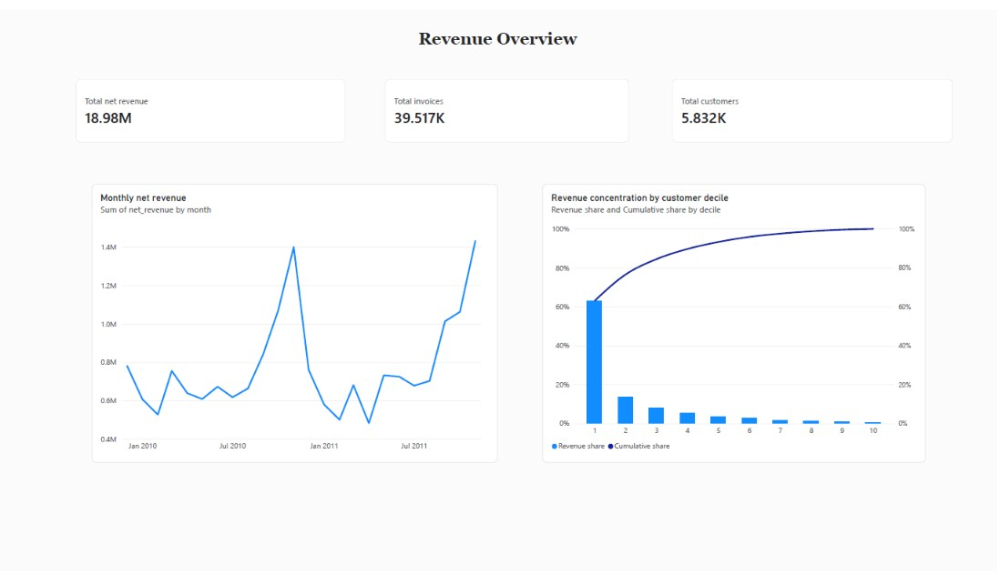
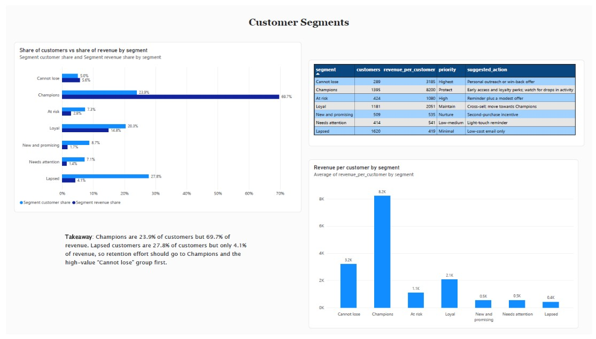
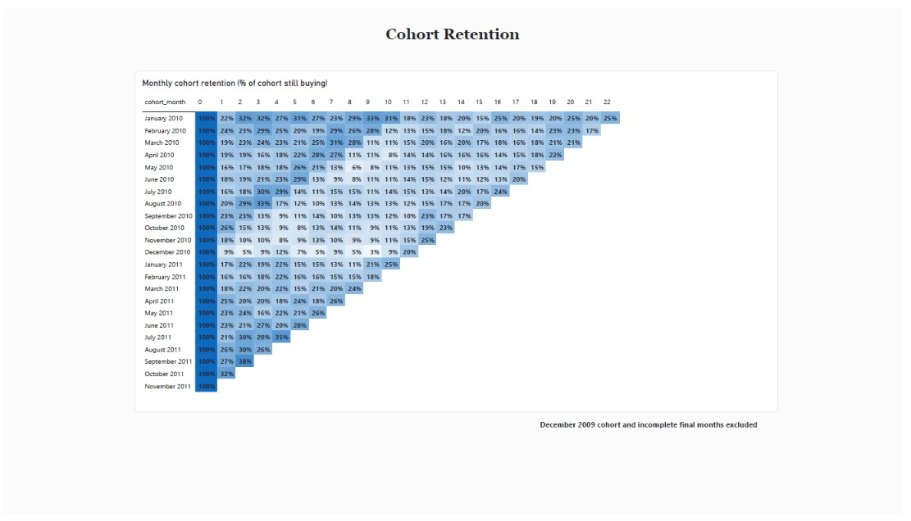
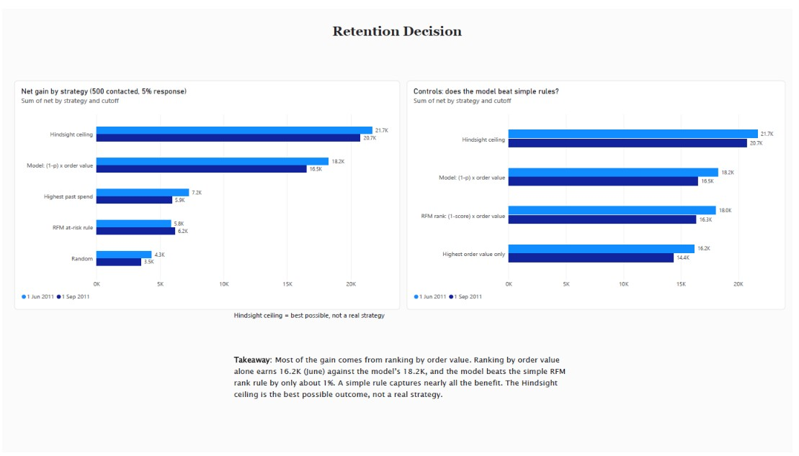
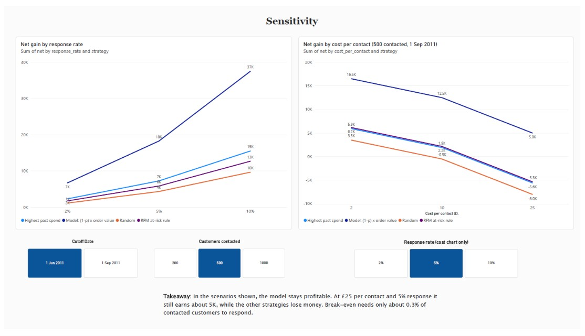

# Customer Retention & Revenue Intelligence

End-to-end analysis of customer retention and revenue on the **UCI Online Retail II** dataset (UK online retailer, Dec 2009 – Dec 2011): SQL analytics, RFM segmentation, a validated repeat-purchase model, a labelled historical backtest of a win-back campaign, and a Power BI dashboard.

**Live demo:** https://customer-retention-intelligence-mbz44pub855e4thaxdvs3v.streamlit.app/

## Key findings
- Top 10% of customers generate about **63% of net revenue**.
- **Champions** are 23.9% of customers but 69.7% of revenue. **Lapsed** customers are 27.8% of customers but 4.1% of revenue.
- A gradient boosting repeat-purchase model ranks customers slightly better than a simple RFM rule on a held-out test cutoff (PR-AUC 0.767 vs 0.749).
- In a win-back backtest, the model-based targeting earned 18.2K net (June 2011 cutoff) and 16.5K (September) against 4.3K and 3.5K for random contact. Most of that gain comes from ranking by order value; the model beat a simple RFM-based rule by only about 1%.

## Data
UCI Online Retail II, both sheets: 1,067,371 raw rows. After cleaning: 1,033,068 rows, 5,875 customers, 18,981,278 net revenue. 5,832 customers were RFM-scored (20 customers with net spend ≤ 0 excluded).

## Approach
| Step | Where | What |
|---|---|---|
| Load and inspect | `notebooks/01_load_and_inspect.ipynb` | Load both sheets, inspect quality issues |
| Cleaning | `notebooks/02_cleaning.ipynb` | Apply cleaning rules, save the clean file |
| SQL analytics | `sql/` | PostgreSQL: monthly revenue, cohort retention, RFM views and segments, revenue concentration |
| Target and gaps | `notebooks/03_purchase_gaps_and_target.ipynb` | Define target: buys again within 90 days of a cutoff, using only prior data |
| Features and models | `notebooks/04_features_and_models.ipynb` | Time-based split, baselines, gradient boosting |
| Test and calibration | `notebooks/05_calibration_test_backtest.ipynb` | Single test on the 1 Sep 2011 cutoff |
| Retention backtest | `notebooks/06_retention_backtest.ipynb` | Compare targeting strategies at two cutoffs, with controls and sensitivity |
| Dashboard exports | `notebooks/07_dashboard_exports.ipynb` | Nine CSVs in `dashboard/data` for Power BI |

**Split:** train cutoffs 2010-09-01, 2010-12-01, 2011-03-01; validation 2011-06-01; test 2011-09-01 (used once).

## Results and caveats
- **Model:** on the test cutoff, gradient boosting PR-AUC is 0.767 against 0.749 for a simple RFM rule. Probabilities came out too low on the test season, so calibration doesn't carry across seasons: the model is usable for **ranking** customers, not for absolute probabilities.
- **Backtest:** the net figures rest on **assumed** parameters, not measured ones: 500 customers contacted, 5% response rate, £2 per contact, 10% discount on recovered orders, order value set to average order value. A sensitivity analysis varies response rate (2%, 5%, 10%) and cost per contact (£2, £10, £25).
- **Controls:** about 85% of the model strategy's gain over random comes from order value alone, and a plain RFM-based score nearly matches the model. The honest conclusion is that a simple rule captures most of the benefit.
- The December 2009 cohort is excluded from retention charts because it includes customers who started before the data begins.

## Dashboard
Built in **Power BI Desktop** from the CSVs in `dashboard/data`.
Files: [`customer_retention_dashboard.pbix`](dashboard/customer_retention_dashboard.pbix) · [PDF export](dashboard/customer_retention_dashboard.pdf)

> Web publishing needs an organisational Power BI licence, which my college tenant doesn't provide, so the dashboard is included as a `.pbix`, a PDF and screenshots.







## Repository structure
```text
notebooks/   analysis notebooks 01–07
sql/         PostgreSQL scripts (revenue trends, cohorts, RFM)
models/      saved model (gb_repeat_purchase.joblib)
results/     test performance and calibration outputs
dashboard/   Power BI file, PDF, screenshots, exported CSVs
app/         Streamlit app
```

## Tech stack
PostgreSQL, Python (pandas, scikit-learn), Power BI, Streamlit, GitHub.


## Reproducing
1. Use Python 3.12 and a virtual environment.
   - Notebooks: `pip install -r requirements-full.txt`
   - Streamlit app only: `pip install -r requirements.txt`
2. Download **Online Retail II** from the UCI Machine Learning Repository (both sheets), and save it as `data/raw/online+retail+ii/online_retail_II.xlsx`. The raw and processed data are not included in this repo (`data/` is git-ignored).
3. Run `notebooks/01_load_and_inspect.ipynb` and `notebooks/02_cleaning.ipynb`. They produce `data/processed/online_retail_clean.csv` (1,033,068 rows).
4. Start PostgreSQL (for example in Docker) and create a database named `retail`. Run `sql/01_schema.sql` to create the `transactions` table, then load `data/processed/online_retail_clean.csv` into it.
5. Run the other SQL scripts in numeric order (`sql/02` to `sql/05`): revenue trends, cohorts, RFM views and segments.
6. Run notebooks 03 to 07 in order. Notebooks 03, 04 and 07 connect to PostgreSQL and ask for the password when run, and nothing is stored. Notebook 07 writes the nine CSVs in `dashboard/data`.
7. Run the app locally with `streamlit run app/app.py`. It only reads the CSVs in `dashboard/data`, so it needs no database.
